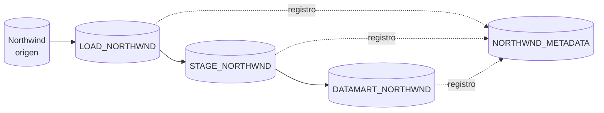
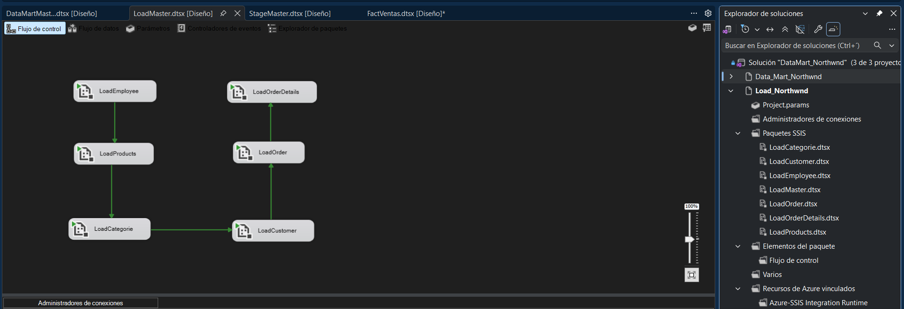
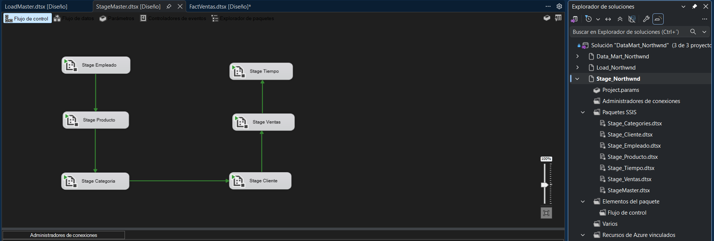
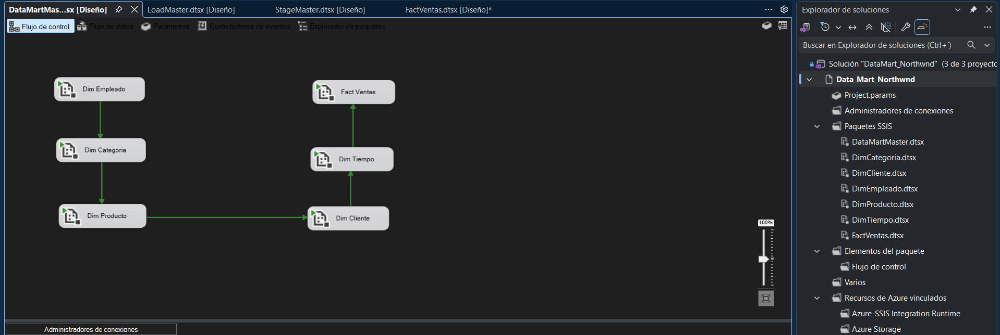
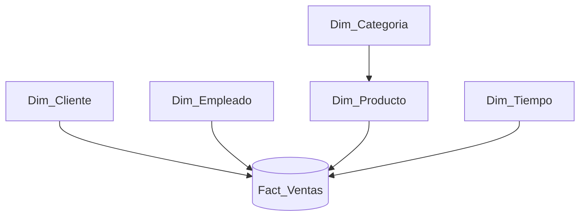
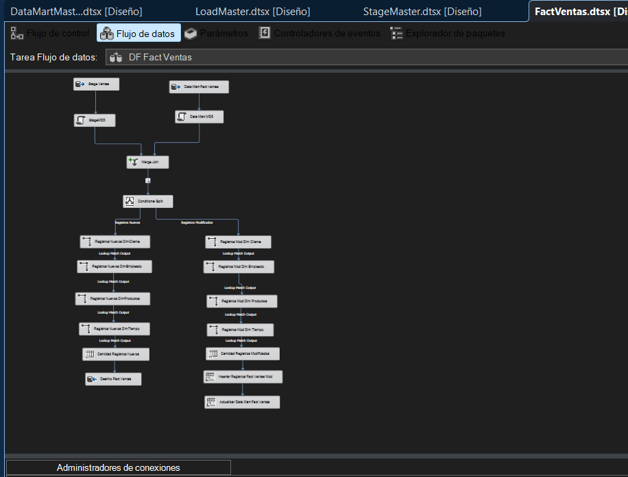

# Data Mart Northwind | ETL, modelado dimensional y trazabilidad

**SQL Server · SSIS · Visual Studio · Data Warehousing**

Proyecto de práctica en el que diseñé e implementé un proceso de integración de datos a partir de **Northwind**, desde su extracción hasta un **Data Mart de ventas con modelo estrella**.

El desafío no era solamente trasladar datos entre bases: buscaba **transformar información transaccional en una estructura preparada para el análisis**, controlar el orden de las cargas, diferenciar registros nuevos de modificados y dejar evidencia de las ejecuciones.

## La solución

| Capa | Responsabilidad |
| --- | --- |
| **LOAD** | Extraer y conservar las cargas del origen, identificadas con fecha y ejecución ETL. |
| **STAGE** | Seleccionar los datos de carga, estandarizar atributos y preparar ventas y tiempo. |
| **DATA MART** | Integrar dimensiones y hechos; distinguir altas de cambios existentes. |
| **METADATA** | Registrar paquete, fecha, entorno y conteos de procesamiento. |

La orquestación se realizó con **tres proyectos de SSIS**, organizados en paquetes maestros (`LoadMaster`, `StageMaster`, `DataMartMaster`) y paquetes especializados. Las dependencias del flujo de control ordenan la ejecución y permiten cargar las dimensiones antes de la tabla de hechos.

<strong>Ver los flujos maestros: Load y Stage</strong>

**Carga desde el origen**

**Preparación de datos**

**Integración del Data Mart**

## Modelo dimensional

El modelo organiza la información alrededor de `Fact_Ventas` y cinco dimensiones, para analizar las ventas desde distintas perspectivas sin depender directamente de las tablas operativas.

Las dimensiones utilizan **claves sustitutas (`SKey`)** para identificar sus registros. En la tabla de hechos se resuelven las referencias de cliente, empleado, producto y tiempo mediante búsquedas (*Lookup*). La categoría participa en el modelo por su relación con productos; el diagrama es conceptual y no sustituye el DDL físico.

## Qué implementé en SSIS

- **Flujo de control:** ejecución organizada de paquetes y dependencias entre entidades.
- **Flujo de datos:** orígenes y destinos OLE DB, columnas derivadas y contadores de filas.
- **Preparación:** tratamiento de atributos, consolidación de órdenes y detalle de pedidos, y dimensión temporal.
- **Detección de cambios:** comparación de datos con MD5, `Merge Join` y `Conditional Split` para distinguir registros nuevos y modificados.
- **Integridad de referencias:** búsquedas `Lookup` contra las dimensiones antes de cargar `Fact_Ventas`.
- **Trazabilidad:** tareas `Execute SQL Task` que registran ejecuciones y actualizan conteos en `NORTHWND_METADATA.dbo.ETLExecution`.

### Ejemplo: carga de la tabla de hechos

En `FactVentas.dtsx` se comparan los datos preparados con los existentes en el destino y se separan las rutas de **inserción** y **actualización**. Cada ruta resuelve las claves dimensionales y contabiliza registros. Este diseño evita reducir la integración a una recarga indiscriminada de todas las filas.

## Evidencia del procesamiento

Las consultas ejecutadas en SQL Server permiten observar **2.155 líneas de venta preparadas** en `STAGE_NORTHWND.Stage_Ventas`, correspondientes a **830 órdenes distintas**. También se construyeron las dimensiones de categoría (8), cliente (91), producto (77) y tiempo (480 registros observados).

Estos valores describen el volumen de datos preparado para el análisis, **sin confundir registros de distintas ejecuciones con ventas adicionales**. La solución incorpora flujos de comparación e inserción/actualización; sus detalles y las consideraciones de conciliación entre etapas están en la [documentación técnica](docs/ARQUITECTURA_ETL.md).

## Por qué tomé estas decisiones

La separación por capas facilita localizar problemas sin mezclar extracción, transformación y consulta analítica. El modelo dimensional organiza la información para análisis; la comparación de cambios evita tratar todas las filas como altas; y la base de metadatos permite conocer **qué paquete procesó datos y cuántos registros reportó**, sin contaminar las tablas de negocio con información operativa del ETL.

## Documentación y exploración

- **[Arquitectura y decisiones técnicas](docs/ARQUITECTURA_ETL.md):** paquetes, transformaciones, auditoría, conteos, validaciones y límites observados.
- **[Script de metadatos](scripts/NORTHWND_METADATA.sql):** definición de `dbo.ETLExecution` (atención: contiene instrucciones destructivas; leer antes de ejecutar).

Para explorar la solución, abrir `DataMart_Northwnd.slnx` en Visual Studio con soporte para proyectos SSIS, configurar las conexiones locales a SQL Server y revisar los paquetes maestros en el orden **Load → Stage → Data Mart**. El entorno de base de datos y sus credenciales deben configurarse por separado.

---

**Proyecto personal de práctica** · Integración de datos · ETL · SQL Server · SSIS · Modelo estrella · Auditoría de ejecuciones
