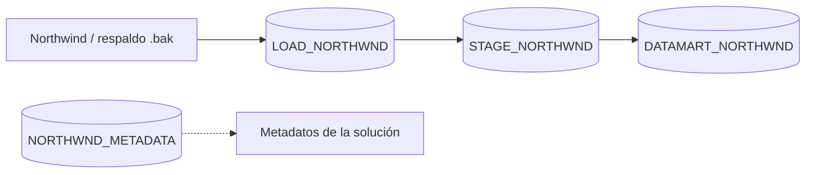
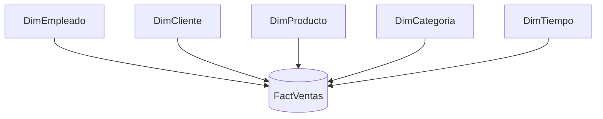

# Data Mart Northwind | ETL y modelado dimensional con SSIS

**Proyecto de integración de datos y Data Warehousing desarrollado con SQL Server, SSIS y Visual Studio.**

A partir de los datos operacionales de **Northwind**, diseñé un proceso ETL por etapas y un **Data Mart de ventas con modelo estrella**, compuesto por una tabla de hechos (`FactVentas`) y dimensiones de análisis.

El objetivo no fue únicamente trasladar registros: también busqué **separar responsabilidades entre capas, organizar dependencias de ejecución y diferenciar la inserción de registros nuevos de la actualización de registros existentes**.

## Arquitectura de datos



| Base de datos | Rol |
| --- | --- |
| `LOAD_NORTHWND` | Recepción de la información del origen Northwind. |
| `STAGE_NORTHWND` | Capa intermedia de preparación y transformación de los datos. |
| `DATAMART_NORTHWND` | Destino analítico con dimensiones y tabla de hechos. |
| `NORTHWND_METADATA` | Base destinada a metadatos; los objetos y usos específicos no se detallan sin revisar su esquema. |

La solución de **SSIS** se organizó en tres proyectos principales: `Load_Northwnd` (nombre en Visual Studio), `Stage_Northwnd` y `Data_Mart_Northwnd`.

## Modelo estrella



**`FactVentas`** concentra los hechos de ventas, mientras que las dimensiones permiten explorar la información por **cliente, empleado, producto, categoría y tiempo**. Esta organización distingue los eventos de negocio de sus atributos descriptivos y facilita el análisis desde múltiples perspectivas.

> El diagrama representa la organización conceptual del modelo. Las claves, cardinalidades, medidas y granularidad exacta requieren consultar las definiciones SQL del Data Mart.

## Proceso ETL en SSIS

### 1. Carga inicial — `LoadMaster.dtsx`

Los paquetes de esta etapa cargan las entidades de Northwind hacia la primera base del proceso. `LoadMaster.dtsx` coordina la ejecución de paquetes como `LoadEmployee`, `LoadProducts`, `LoadCategorie`, `LoadCustomer`, `LoadOrder` y `LoadOrderDetails`, conectados mediante restricciones de precedencia.

<details>
<summary><strong>Ver flujo de control de la carga inicial</strong></summary>


</details>

### 2. Preparación — `StageMaster.dtsx`

La capa de *staging* organiza el procesamiento intermedio con paquetes para empleados, productos, categorías, clientes, ventas y tiempo. El flujo maestro establece el orden de ejecución entre estos paquetes.

<details>
<summary><strong>Ver flujo de control de staging</strong></summary>


</details>

### 3. Integración dimensional — `DataMartMaster.dtsx`

El último proyecto carga las **dimensiones** y luego la **tabla de hechos**, respetando la secuencia de dependencias definida en el flujo de control.


### 4. Registros nuevos y modificados — `FactVentas.dtsx`

El flujo de datos de `FactVentas` combina información de entrada con datos ya existentes en el Data Mart y utiliza un **Conditional Split** para separar **registros nuevos** de **registros modificados**.

En ambas rutas se observan búsquedas (*Lookup*) contra las dimensiones. Los registros nuevos se dirigen a una carga de inserción, mientras que los modificados continúan por un recorrido de actualización. Este diseño permite evitar tratar todas las filas como si fueran altas nuevas.


> Los criterios exactos de detección de cambios, las expresiones utilizadas y la política de actualización deben verificarse dentro del paquete `.dtsx`.

## Herramientas y conceptos aplicados

| Tecnología / concepto | Aplicación en el proyecto |
| --- | --- |
| SQL Server | Almacenamiento en las distintas capas del proceso. |
| SSIS | Extracción, transformación, carga y orquestación. |
| Visual Studio / SSDT | Desarrollo y organización de los paquetes. |
| Control Flow | Secuenciación y dependencias entre tareas. |
| Data Flow | Transformación y direccionamiento de registros. |
| Lookups y Conditional Split | Correspondencia con dimensiones y separación de rutas de carga. |
| Modelado dimensional | Estructura analítica con `FactVentas` y dimensiones. |

## Estructura del repositorio

```text
DataMart_Northwnd/
├── DataMart_Northwnd/       # Proyecto de carga (carpeta publicada)
├── Stage_Northwnd/          # Proyecto de staging
├── Data_Mart_Northwnd/      # Proyecto de Data Mart
├── images/                  # Capturas documentales
│   ├── load-master.png
│   ├── stage-master.png
│   ├── datamart-master.png
│   └── fact-ventas-flujo.png
├── docs/
│   └── ARQUITECTURA_ETL.md
├── DataMart_Northwnd.slnx
└── README.md
```

## Cómo explorar la solución

1. Clonar o descargar este repositorio.
2. Abrir la solución `DataMart_Northwnd.slnx` desde una instalación compatible de Visual Studio con soporte de SSIS.
3. Revisar los administradores de conexión, parámetros y rutas de cada proyecto.
4. Disponer de SQL Server y del origen Northwind; preparar las bases de datos requeridas.
5. Inspeccionar los paquetes maestros y los flujos de datos individuales antes de ejecutar el proceso.

**Nota:** las conexiones locales, rutas y credenciales deben configurarse según el entorno. El repositorio no implica que la ejecución sea automática sin preparar los orígenes y destinos.

## Documentación técnica

Para revisar cada etapa, sus paquetes y las decisiones pendientes de verificación, consultar **[Arquitectura y procesos ETL](docs/ARQUITECTURA_ETL.md)**.

## Aprendizajes

Este proyecto me permitió poner en práctica el diseño de una arquitectura ETL por capas, la **construcción de un modelo dimensional** y la gestión de flujos de datos que contemplan tanto nuevas incorporaciones como cambios en registros existentes. También reforzó la importancia de que un pipeline sea comprensible y fácil de mantener, no solo funcional.

---

**Proyecto personal de práctica** · SQL Server · SSIS · ETL · Data Warehousing · Modelado dimensional
