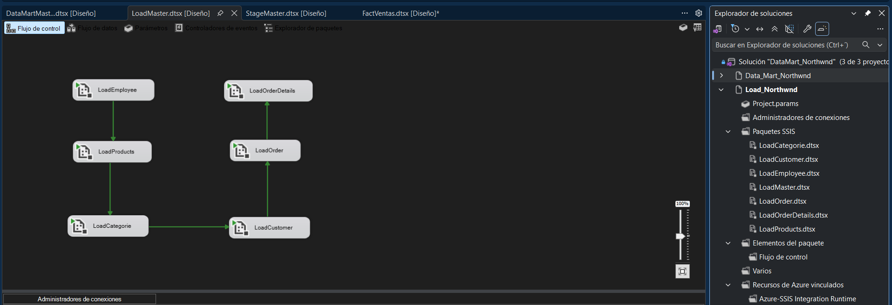
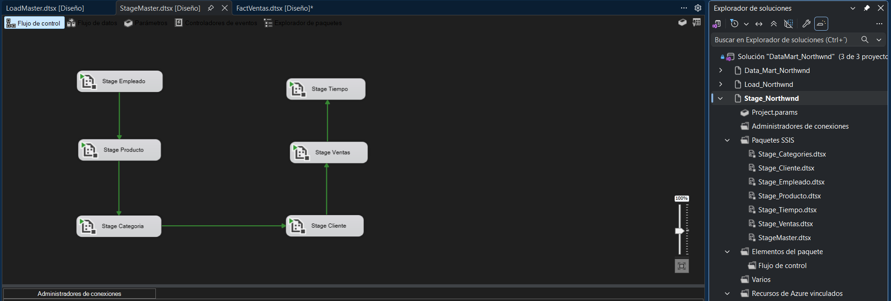
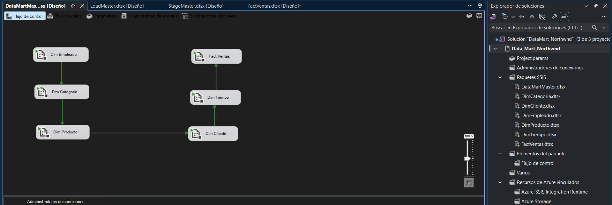
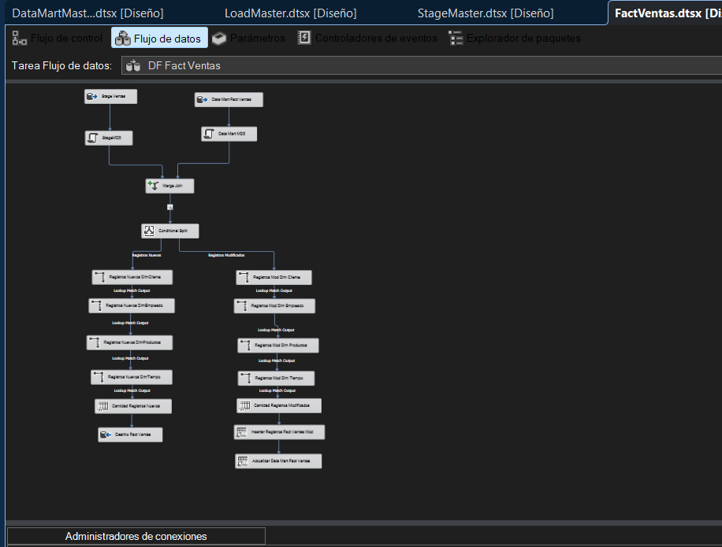

# Documentación técnica — Data Mart Northwind

Esta documentación acompaña al [README principal](../README.md) y describe los procesos observables en los paquetes maestros y en `FactVentas.dtsx`.

## 1. Capas y responsabilidades

| Base | Propósito |
| --- | --- |
| `LOAD_NORTHWND` | Carga de datos operacionales procedentes de Northwind. |
| `STAGE_NORTHWND` | Preparación y transformación de datos intermedios. |
| `DATAMART_NORTHWND` | Almacenamiento analítico dimensional. |
| `NORTHWND_METADATA` | Entorno separado de metadatos; faltan definiciones de tablas y usos específicos. |

El respaldo `Northwind.bak` constituye el punto de partida mencionado para el origen. Cada etapa cumple una responsabilidad distinta y permite analizar los problemas en el tramo correspondiente.

## 2. Orquestación de paquetes

### Carga inicial (`LoadMaster.dtsx`)

En el flujo se observan las tareas `LoadEmployee`, `LoadProducts`, `LoadCategorie`, `LoadCustomer`, `LoadOrder` y `LoadOrderDetails`. Las flechas verdes representan restricciones de precedencia configuradas entre tareas.

### Staging (`StageMaster.dtsx`)

El flujo muestra la secuencia `Stage Empleado` → `Stage Producto` → `Stage Categoria` → `Stage Cliente` → `Stage Ventas` → `Stage Tiempo`. Los paquetes de la solución están separados por entidad.

### Data Mart (`DataMartMaster.dtsx`)

Se aprecia la secuencia de carga de dimensiones —empleado, categoría, producto, cliente y tiempo— antes de la ejecución de `Fact Ventas`. El orden facilita que las búsquedas de claves dimensionales se realicen sobre dimensiones previamente cargadas.

## 3. Modelo dimensional

- `FactVentas`: tabla central de hechos de ventas.
- `DimEmpleado`: contexto de empleado.
- `DimCategoria`: contexto de categoría.
- `DimProducto`: contexto de producto.
- `DimCliente`: contexto de cliente.
- `DimTiempo`: contexto temporal.

**Pendiente de verificar en SQL:** grano de la tabla de hechos; claves subrogadas o naturales; relaciones y cardinalidades; métricas almacenadas; reglas para filas desconocidas o nulas.

## 4. Flujo de datos de `FactVentas.dtsx`

La captura permite distinguir dos entradas de información, transformaciones previas, un `Merge Join`, un `Conditional Split` y dos rutas:

- **Registros nuevos:** se realizan consultas `Lookup` a dimensiones, se cuenta la cantidad de filas procesadas y se destinan al flujo de inserción en la tabla de hechos.
- **Registros modificados:** se realizan búsquedas dimensionales, se cuenta la cantidad de filas y se continúa por pasos de inserción y actualización según los destinos identificados en la interfaz.

La presencia de estos componentes confirma el diseño de dos recorridos. **No alcanza para demostrar** una estrategia SCD concreta, las reglas de comparación, cómo se evitan duplicados, el manejo de errores o la existencia de auditoría persistente: esos puntos requieren revisar las propiedades del paquete y/o ejecutar pruebas.

## 5. Control Flow frente a Data Flow

El **flujo de control** define qué tareas se ejecutan y bajo qué dependencias. El **flujo de datos** define cómo se extraen, unen, buscan y encaminan las filas dentro de una tarea específica.

Esta separación hace que el proyecto sea más fácil de inspeccionar: cada paquete tiene una finalidad, y los paquetes maestros presentan el recorrido de ejecución de una etapa completa.

## 6. Para completar la documentación con evidencia

| Aspecto | Evidencia útil |
| --- | --- |
| Modelo estrella | Scripts de `CREATE TABLE` o diagrama de relaciones de SQL Server. |
| Carga incremental | Condición de `Conditional Split` y columnas comparadas. |
| Reglas de transformación | Configuración de transformaciones y consultas SQL dentro de los paquetes. |
| Control de calidad | Manejo de errores, filas rechazadas, nulos y duplicados. |
| Metadatos | Tablas y consultas de `NORTHWND_METADATA`. |
| Resultado | Cantidades de filas por etapa y comprobaciones en destino. |

Documentar esas evidencias permitiría describir con precisión las reglas de negocio y los criterios de actualización sin asumir funciones no verificadas.
